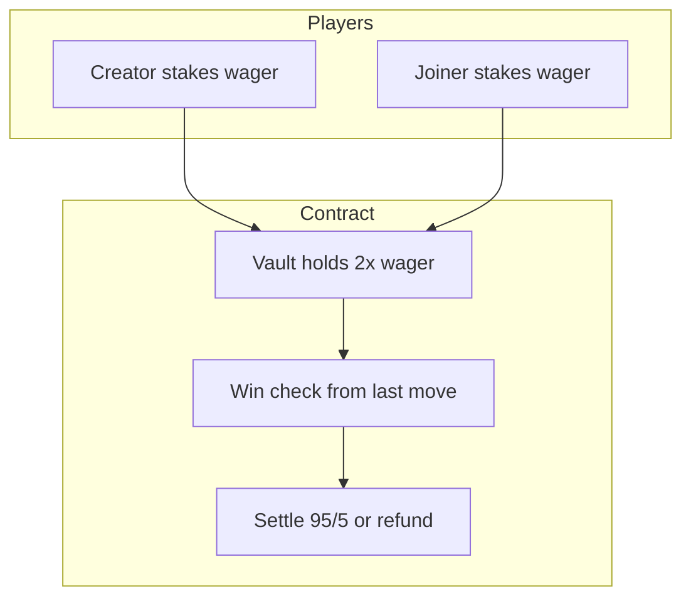

<div align="center">

# 🎄 Sui × Lofi Caro

### *On-chain PvP Gomoku — five in a row takes the pot.*

**Sui · Lofi the Yeti · CLAY Hackathon III**

<br />

[](https://hackathon.lofitheyeti.com/)
[](https://hackathon.lofitheyeti.com/)
[](https://suiscan.xyz/mainnet/object/0x3a481fe1977237ae7b74b23d03817616e0a967d61e48f4f726d315e5329f1278)

<br />

[](https://suiscan.xyz/mainnet/object/0x3a481fe1977237ae7b74b23d03817616e0a967d61e48f4f726d315e5329f1278)
[](https://github.com/Olympusxvn/sui-lofi-caro)
[](docs/SPEC.md)

<br />

[](https://nextjs.org/)
[](https://www.typescriptlang.org/)
[](https://sui.io/)
[](LICENSE)

<br />

> **New here?** Start at [For judges](#️-for-judges--5-min-verify), then play the free practice board, no wallet needed.

<br />

```
. . . . . . . . . . . . . . .
. . . . . . . . . . . . . . .
. . 💧 💧 💧 💧 💧 . . . . . .
. . . . . . . . . . . . . . .
. . . . . . . . . . . . . . .
        five in a row — 95% of the pot
```

</div>

---

## 📑 Contents

| | |
|:---|:---|
| ⚖️ | [For judges](#️-for-judges--5-min-verify) |
| 🎬 | [Demo / How to play](#-demo--how-to-play) |
| 🏗️ | [Overview](#️-overview) |
| ⚡ | [Quick start](#-quick-start) |
| ⛓️ | [On-chain](#️-on-chain) |
| 📜 | [Scripts](#-scripts) |
| 📚 | [Documentation](#-documentation) |
| 🔗 | [References](#-references) |
| ✅ | [Checklist](#-checklist) |
| 🔒 | [Security](#-security) |

---

<div align="center">

## ⚖️ For judges — 5 min verify

**No secrets, no wallet, no funds needed to verify the contract and the live deployment.**

</div>

```bash
# 1. Contract tests — 13/13 pass, fully offline
sui move test --path move

# 2. Frontend build check
cd frontend && npm install && npm run build

# 3. Play the free practice board (no wallet) at http://localhost:3000
npm run dev
```

| 🔗 Resource | 📍 Link |
|:------------|:--------|
| **⛓️ Package** | [Suiscan — 0x3a48…f1278](https://suiscan.xyz/mainnet/object/0x3a481fe1977237ae7b74b23d03817616e0a967d61e48f4f726d315e5329f1278) |
| **⚙️ ProtocolConfig** | [Suiscan — 0x0361…c527](https://suiscan.xyz/mainnet/object/0x03617ace2e68ff0ca113af3bf944b54fe272f12a30b06d16ba2f8feee16ac527) |
| **📄 Spec** | [docs/SPEC.md](docs/SPEC.md) |
| **📜 Rules** | [docs/RULE.md](docs/RULE.md) |
| **💻 Repo** | [Olympusxvn/sui-lofi-caro](https://github.com/Olympusxvn/sui-lofi-caro) |

---

## 🎬 Demo / How to play

Two players stake SUI in an on-chain vault. First to five in a row on the 15×15 board takes **95%** of the pot; **5%** goes to the protocol treasury. Draws refund 100% (0% fee). Every move, win check and payout runs in the Move contract, no server, no trust.

| Piece | Player | Moves |
|:------|:-------|:------|
| 💧 Sui droplet | Player 1 (X) | First |
| 🧊 Lofi the Yeti head | Player 2 (O) | Second |

- **No NFTs, no custom tokens**, only native SUI, ever.
- **Free practice board** (hotseat, off-chain) needs no wallet.
- **Live game**: connect a Slush / standard Sui wallet, create or join a room, stake 0.1 SUI or more.
- **5-minute turn timer** with timeout claim; victory / draw modal links straight to Suiscan.

> Website deploy is pending (Vercel team-scope 403, same as the project's earlier deploys). The frontend builds clean and runs locally; see [Checklist](#-checklist).

---

## 🏗️ Overview

| Layer | Responsibility |
|:------|:---------------|
| **🖥️ Frontend** | Next.js 15 + React 19 + Tailwind v4, Slush Wallet, live balance, lobby, 15×15 ice board |
| **⛓️ Contract** | Move (edition 2024), one `GameRoom` shared object per match, vault in `Balance<SUI>` |
| **💰 Economics** | 0.1 SUI min wager, 500 bps fee, `u128` intermediate math, atomic settlement |
| **⏱️ Fairness** | `Clock` (`0x6`) per-turn timeout, win checked from the last move on 4 axes |



### Smart contract

| Item | Value |
| --- | --- |
| Board | `vector<u8>` length 225: `0` empty, `1` Sui (X), `2` Lofi (O) |
| Min wager | `0.1 SUI` (100,000,000 MIST) |
| Fee | `500 bps` (5%), `u128` intermediate math, zero overflow |
| Payout | Winner `95%`, treasury `5%` |
| Timeout | `300,000 ms` (5 min) per turn, `Clock` (`0x6`) enforced |
| Statuses | `0` WAITING, `1` IN_PROGRESS, `2` FINISHED, `3` CANCELLED |

Functions: `create_room`, `join_room`, `make_move`, `cancel_room`, `claim_timeout_win`, plus admin `update_treasury` / `set_paused` / `set_min_wager` (via `AdminCap`).

### Test the contract

```bash
sui move test --path move
```

Tests cover horizontal / vertical / diagonal / anti-diagonal wins with exact 95% / 5% balance assertions, draw 50/50 refund, room cancellation, timeout win, and aborts for wrong turn, wrong wager, occupied cell, self-play, wager too low, and early timeout.

---

## ⚡ Quick start

```bash
# Contract (Sui CLI 1.85.1)
sui move test --path move     # 13/13 pass
sui move build --path move    # offline; produces move/build/.../caro.mv

# Frontend
cd frontend
npm install
npm run dev    # http://localhost:3000
npm run build  # production build check
```

The frontend reads `NEXT_PUBLIC_PACKAGE_ID` / `NEXT_PUBLIC_CONFIG_ID` from `.env.local` when set, and otherwise falls back to the live mainnet deployment in `frontend/src/constants/config.ts`. Network defaults to mainnet; set `NEXT_PUBLIC_SUI_NETWORK=testnet` for the demo network.

---

## ⛓️ On-chain

Live on **Sui mainnet** since 2026-11-26. Publish cost: **0.0365 SUI** (gas + storage).

| 🔗 Item | 📍 Value |
|:--------|:---------|
| **Package ID** | `0x3a481fe1977237ae7b74b23d03817616e0a967d61e48f4f726d315e5329f1278` |
| **ProtocolConfig ID** | `0x03617ace2e68ff0ca113af3bf944b54fe272f12a30b06d16ba2f8feee16ac527` |
| **Treasury (5% fee)** | `0x0af0ce88e416d5fb14e1f098d93cc5eaf5c89b847c39bac0c969b4c9604f9155` |
| **Suiscan** | [Package](https://suiscan.xyz/mainnet/object/0x3a481fe1977237ae7b74b23d03817616e0a967d61e48f4f726d315e5329f1278) · [Config](https://suiscan.xyz/mainnet/object/0x03617ace2e68ff0ca113af3bf944b54fe272f12a30b06d16ba2f8feee16ac527) |
| **Tests** | 13/13 pass (`sui move test`) |

To republish (new package, Move packages are immutable):

```bash
sui move build --path move   # offline; produces move/build/.../caro.mv
node frontend/scripts/publish-mainnet.mjs --dry   # simulate only
node frontend/scripts/publish-mainnet.mjs        # publish for real
# Then update MAINNET_PACKAGE_ID / MAINNET_CONFIG_ID in
# frontend/src/constants/config.ts (env vars override them).
```

Publishing uses the GraphQL endpoint (`frontend/scripts/publish-mainnet.mjs`): the Sui CLI's gRPC transport is blocked by this machine's egress proxy, and public fullnodes have deprecated JSON-RPC. The key is read at runtime from a local wallet file and is never in this repo.

To move the 5% fee to another wallet (admin only, via `AdminCap`):

```bash
node frontend/scripts/update-treasury.mjs <0x...64-hex-address> [--dry]
```

---

## 📜 Scripts

| 📄 Script | 🎯 Purpose |
|:----------|:-----------|
| `frontend/scripts/publish-mainnet.mjs` | Simulate, then publish the package to mainnet via GraphQL |
| `frontend/scripts/update-treasury.mjs` | Move the 5% fee recipient (admin, `update_treasury`) |
| `sui move test --path move` | 13 Move unit tests |
| `npm run dev` / `npm run build` | Frontend dev server / production build |

---

## 📚 Documentation

| 📄 Document | 🎯 Purpose |
|:------------|:-----------|
| [docs/PROJECT.md](docs/PROJECT.md) | Project plan |
| [docs/PRD.md](docs/PRD.md) | Product requirements |
| [docs/SPEC.md](docs/SPEC.md) | Technical spec (board, economics, events) |
| [docs/RULE.md](docs/RULE.md) | Hard rules (no NFTs, USD-free SUI only, caps) |
| [docs/MUSE_PROMPT.txt](docs/MUSE_PROMPT.txt) | Original build prompt |
| [LICENSE](LICENSE) | MIT License, Copyright 2026 Olympusxvn |

---

<details>
<summary><strong>🔗 References</strong></summary>

| Resource | URL |
|:---------|:----|
| CLAY Hackathon III | https://hackathon.lofitheyeti.com/ |
| Lofi the Yeti on X | https://x.com/lofitheyeti |
| Sui docs | https://docs.sui.io/ |
| Suiscan (mainnet) | https://suiscan.xyz/mainnet |
| Sui TypeScript SDK | https://sdk.mystenlabs.com/typescript |

</details>

---

## ✅ Checklist

- [x] Public GitHub repo (this one)
- [x] Package ID `0x3a481fe1977237ae7b74b23d03817616e0a967d61e48f4f726d315e5329f1278` (mainnet, live 2026-11-26)
- [x] MIT License
- [ ] Demo video, 3–5 minutes (YouTube link preferred)
- [ ] Project logo, 1:1 (the Lofi yeti head PNG from the LOFI.rar asset pack; in the app it is embedded as a data URI in `frontend/src/components/pieceImages.ts`)
- [ ] Website (deploy the frontend; Vercel team-scope 403, deploy from a machine with team access)

---

## 🔒 Security

- Never commit `.env.local` or any private key / mnemonic. The deployer key lives only in your local Sui keystore (`~/.sui`), never in this repo.
- The contract never holds pooled funds beyond one match vault, has no withdrawal function, and pays out atomically inside the winning / timeout / draw transaction.
- The 5% fee recipient is the `ProtocolConfig.treasury` address, changeable only by the `AdminCap` holder.

---

<div align="center">

**Sui × Lofi Caro**

*On-chain PvP Gomoku — five in a row takes the pot.*

[](https://github.com/Olympusxvn/sui-lofi-caro/stargazers)

MIT License · Copyright 2026 Olympusxvn · Built for CLAY Hackathon III

</div>
